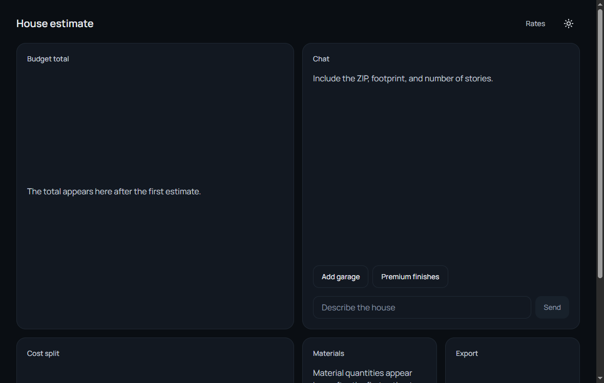
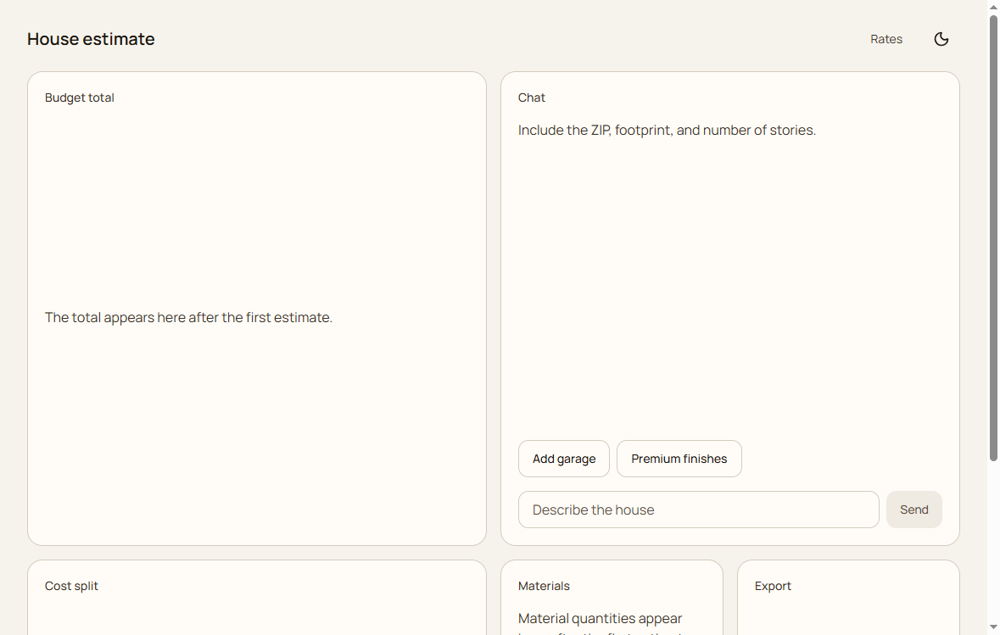
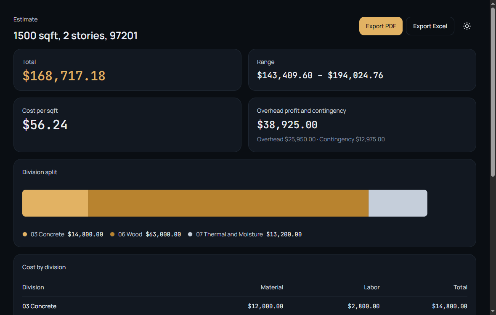
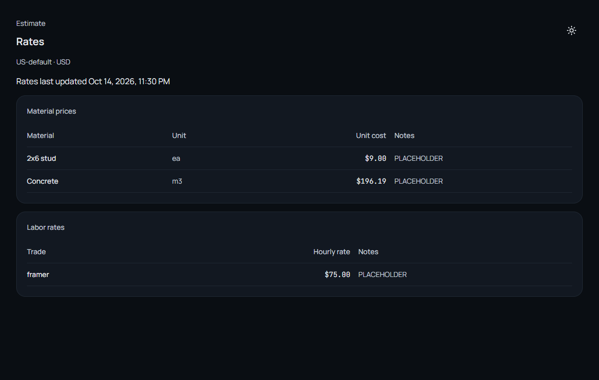
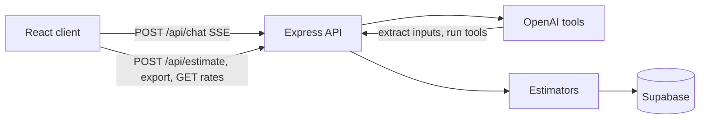

# Construction estimation agent

Budget estimates for a wood-frame house. Western market, US first.

The model never does the arithmetic. It extracts house inputs, calls tools, and explains the result. Quantities, costs, the low/high range, and allowances come from tested functions in `server/src/estimators/`. Rates, quantity factors, and percentages live in the database.

Every estimate shows the assumptions used, a low/high range, and this line:

> Budget estimate only. Not a bid or structural design.

## Screenshots









## Architecture



The chat agent can call `extract_house_inputs`, `run_estimate`, `compare_scenarios`, and `get_rates`. `run_estimate` calls `estimateHouse`. The client saves that result with `POST /api/estimate` so the report and PDF/Excel export have an id.

## Setup

Requirements: Node.js 22+, a Supabase project, and an OpenAI API key.

```bash
cd server
npm install
copy .env.example .env
```

In the Supabase SQL editor, run `server/src/db/schema.sql`, then `server/src/db/seed.sql`. If the tables already exist from an older schema, run `server/src/db/migrations/001_rate_updated_at.sql` as well. That adds `updated_at` on material prices and labor rates. The rates screen uses the newest of those timestamps for **Rates last updated**.

Seed numbers are placeholders. Replace them in the database. Do not hardcode rates in the estimators.

```bash
cd client
npm install
copy .env.example .env
```

Leave `VITE_API_URL` empty locally. Vite proxies `/api` to `http://localhost:3000`.

Start the API, then the client:

```bash
cd server
npm start
```

```bash
cd client
npm run dev
```

Open `http://localhost:5173`.

## Environment

Server values are in `server/.env.example`. Client values are in `client/.env.example`.

| Variable | Where | Purpose |
| --- | --- | --- |
| `PORT` | server | API port. Defaults to 3000. |
| `HOST` | server | Bind address. Defaults to `0.0.0.0` so a host can reach the process. |
| `CLIENT_ORIGIN` | server | Comma-separated browser origins for CORS. Empty allows any origin, which is for local development. |
| `SUPABASE_URL` | server | Supabase project URL. |
| `SUPABASE_SERVICE_ROLE_KEY` | server | Service role key. Server only. Never put this in the client. |
| `OPENAI_API_KEY` | server | OpenAI key for the chat agent. |
| `OPENAI_MODEL` | server | Chat model. Defaults to `gpt-4o-mini`. |
| `VITE_API_URL` | client | API origin with no `/api` suffix. Empty in local development. |

## Scripts

```bash
cd server && npm test
cd client && npm run dev
cd client && npm run build
```

## Using the app

Tab order starts at **Skip to content**, then the page links, then the theme button, then the chat. The theme button is icon-only and labeled **Use light theme** or **Use dark theme**. The choice is stored in the browser. Light colors are the `.light` overrides of the same CSS variables.

Streamed assistant replies sit in an `aria-live="polite"` region. Tool status such as "Running the estimate" is a status message. Empty panels say what is missing. Chat, report, and rates errors stay on screen with **Try again** where a retry is possible.

Assumption chips can be changed from the keyboard. Escape cancels the edit.

Animations, including skeleton pulse and chart motion, follow `prefers-reduced-motion`.

## Deployment

The client is a static Vite app. The API is a Node process.

### Client on Vercel

1. Import the repo and set the root directory to `client`.
2. Framework preset: Vite. Build command: `npm run build`. Output: `dist`.
3. Set `VITE_API_URL` to the API origin, for example `https://construction-estimation-api.onrender.com`. No trailing slash.
4. `client/vercel.json` rewrites unknown paths to `index.html` so `/report/:id` and `/rates` work on refresh.

### Server on Render

`render.yaml` at the repo root defines a Node web service with root directory `server`, start command `npm start`, and health check `/health`.

In the Render dashboard, set `SUPABASE_URL`, `SUPABASE_SERVICE_ROLE_KEY`, `OPENAI_API_KEY`, and `CLIENT_ORIGIN` to the Vercel origin, for example `https://your-app.vercel.app`. Add preview origins in the same variable, separated by commas, if those URLs should call the API.

### Server on Railway

Create a service from this repo and set the root directory to `server`. `server/railway.toml` starts `npm start` and checks `/health`. Set the same environment variables as Render, including `CLIENT_ORIGIN`.

Chat sessions are stored in memory on the API process. A restart clears them. Saved estimates stay in Supabase.
