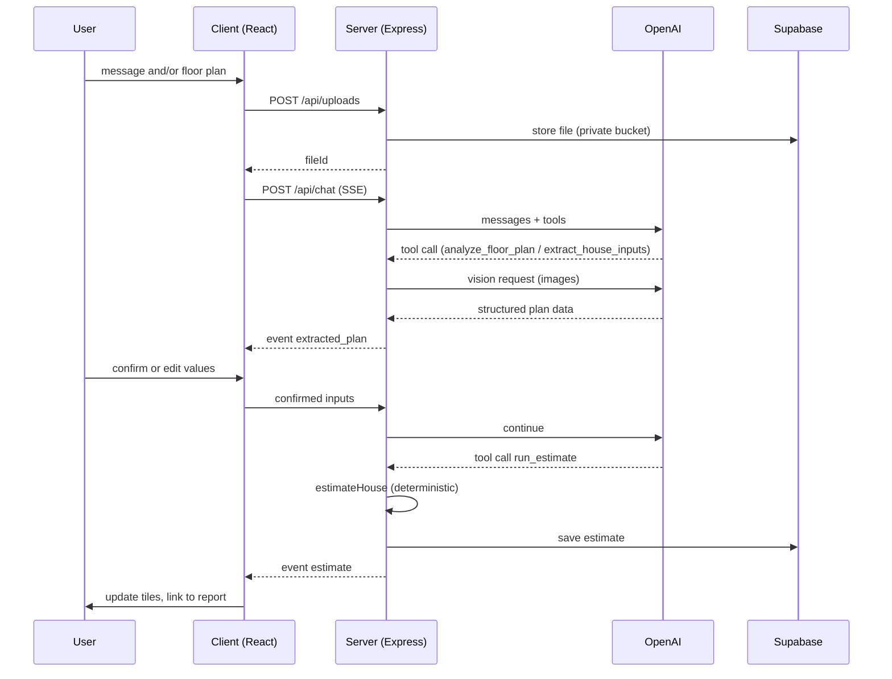

# Architecture and flow

## End-to-end flow
1. User opens the chat; a session id is created.
2. User describes the house in text and/or attaches a floor plan (PNG, JPG, PDF).
3. Attachments go to POST /api/uploads, are validated, stored in a private bucket, and a fileId is returned.
4. Client calls POST /api/chat (SSE) with { sessionId, message, fileIds }.
5. The agent decides which tool to call:
   - extract_house_inputs for text descriptions
   - analyze_floor_plan(fileId) for attachments
6. If required inputs are missing (ZIP, footprint sqft, stories), the agent asks the user. It never guesses required inputs.
7. After a plan is analyzed, the UI shows an editable "Extracted from your plan" card. The estimate does NOT run until the user confirms or corrects the values.
8. run_estimate(inputs) calls the deterministic estimateHouse function (no LLM math), saves the result, and returns it.
9. The UI updates the Bento tiles: total and range, cost split, materials, assumptions.
10. What-if requests ("add a garage", "premium finishes") call compare_scenarios, which runs two estimates and returns the difference.
11. /report/:id shows the full report; export to PDF or Excel.

## Sequence

## Data contracts
- HouseInputs: { region, zip, footprintSqft, stories, foundation, roofPitch, garage, bedrooms, bathrooms, finishGrade, hvacType }
- EstimateResult: { id, assumptions[], divisions[], materials[], notIncluded[], totals: { direct, total, low, high, perSqft, scopeLabel }, ratesUpdatedAt }
- Sales tax and labor burden come from the region. Overhead and profit is applied first, then contingency compounds on that result: total = (direct + sales tax + labor burden) × (1 + overhead) × (1 + contingency).
- While notIncluded scopes are outside the estimate, totals.scopeLabel is "Partial estimate". Priced scope includes site excavation and grading, openings, plumbing fixtures and the water heater, the breaker panel and light fixtures, ductwork by floor area, framed plates, corners, headers, and stairs.
- PlanExtraction: { rooms[], footprintSqft, stories, scaleFound, scaleNote, confidence, warnings[] }
- SSE events: token, tool_status, extracted_plan, estimate, error, done

## Rules
- The LLM never computes numbers; only deterministic functions in server/src/estimators do.
- Every estimate lists its assumptions and shows a low/high range.
- Every estimate shows: "Budget estimate only. Not a bid or structural design."
- Uploads: allowed types and size limits are enforced on client and server; files are private and auto-deleted after 7 days.

## Error handling
- Missing price or rate: fail with a clear message naming the missing item.
- Vision fails or scaleFound is false: ask the user for one known dimension.
- OpenAI or network error: send an error event, keep the session state, and allow retry.
